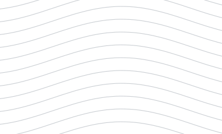
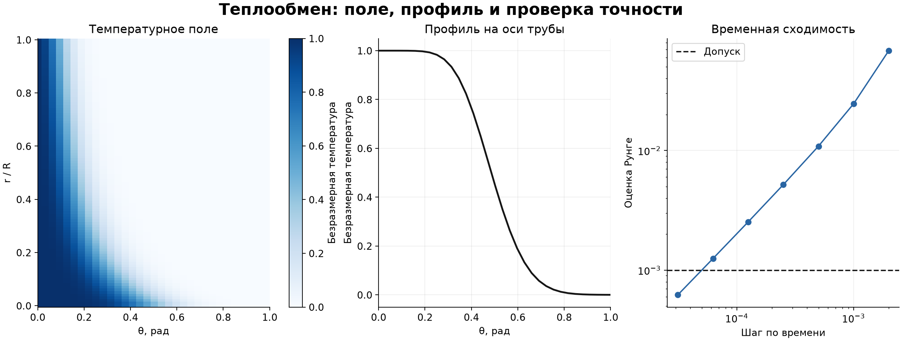

# Численное моделирование и проверка точности

<br clear="all">

## Теплообмен на Python: расчёт и контроль сходимости

В разборе ниже использую исходный учебный набор. Результаты для текущих данных и параметров доступны в [отчёте расчёта](generated/REPORT.md).

Я решил учебную задачу конвективного теплообмена с помощью NumPy: рассчитал температурное поле и проверил точность, последовательно уменьшая временной шаг.

При шаге **3,125 × 10⁻⁵** оценка временной погрешности — **6,21 × 10⁻⁴**, ниже допуска **10⁻³**. Наблюдаемый порядок — **1,0084**.


*На рисунке показан участок θ до 1,3 рад. Полное поле рассчитано до π; время безразмерное, τ = 0,1.*

<details>
<summary>Поле, профиль температуры и сходимость</summary>



[Все варианты и расчёты](generated/REPORT.md) · [Масштабируемый SVG](generated/heat-overview.svg)

</details>

### Применённые навыки

| Навык аналитика | Как я его применил |
|---|---|
| Формализация задачи | Перевёл физическую постановку в параметры, начальные и граничные условия |
| Работа с массивами | Рассчитывал поле на сетке 101 × 101 в NumPy |
| Проверка надёжности модели | Контролировал устойчивость явной схемы и граничные невязки |
| Анализ точности | Уменьшал временной шаг и оценивал сходимость |
| Воспроизводимость | Задал параметры в конфигурации и подготовил код повторения расчёта |
| Интерпретация | Отделил численную точность от достоверности прогноза реального объекта |

### Результаты расчёта

| Показатель | Значение |
|---|---:|
| Пространственная сетка | 101 × 101 |
| Конечное время | 0,1 |
| Итоговый временной шаг | 0,00003125 |
| Оценка временной погрешности | 0,000621254 |
| Допуск | 0,001 |
| Наблюдаемый порядок | 1,0084 |

### Пример кода

```python
from heat_model import Parameters, solve

parameters = Parameters(time_step=0.00003125, final_time=0.1)
solution = solve(parameters, snapshot_times=())
print(solution.temperature.shape)  # (101, 101)
```

### Код и результаты

- [heat_model.py](heat_model.py) — решатель задачи конвективного теплообмена на NumPy.
- [reproduce.py](reproduce.py) — повторяет расчёт и сравнивает осевой профиль с контрольными значениями.
- [check_saved_result.py](check_saved_result.py) — пример проверки допуска и граничных невязок.
- [heat-results.json](heat-results.json) — параметры, история сходимости и контрольные значения.
- [saved-field.csv](saved-field.csv) — контрольный осевой профиль.
- [reproduced-field.csv](reproduced-field.csv) — полное поле 101 × 101, полученное при повторении расчёта.

### Для каких аналитических задач это полезно

Проверка расчётных моделей, поиск источников численной ошибки, ведение воспроизводимых вычислений и объяснение точности результата. Такой контроль помогает избежать вывода по красивому, но непроверенному графику.

### Дополнительный опыт

В Excel я сравнивал модели Мальтуса и Ферхюльста по одному временному ряду: RMSE 0,245553 и 0,050804 млрд человек. Исследовал равновесия и устойчивый цикл периода 2 дискретной модели. Для электрических цепей применял метод наименьших квадратов, определял параметры элементов и проверял невязки физических балансов. В этих задачах учился выбирать модель по ошибке, подбирать параметры и проверять согласованность расчёта.

### Изученные методы

В университетской подготовке изучал следующие методы и модели.

| Направление | Методы и задачи |
|---|---|
| Численные расчёты | Решение уравнений и систем, интегрирование, интерполяция, методы Эйлера и Рунге — Кутты |
| Оптимизация | Перебор, дихотомия и градиентные методы |
| Дискретизация | Явные и неявные схемы для диффузионных и волновых задач, метод Кранка — Николсона, анализ устойчивости и сходимости |
| Физическое моделирование | Конвективный теплообмен, многофазные среды и турбулентные течения; методы контрольного объёма и конечных элементов, алгоритм SIMPLE и модель k–ε |

Эта подготовка помогает мне автоматизировать расчёты, сравнивать модели по общей метрике, анализировать чувствительность и проверять численные выводы.

### Ограничения

Здесь проверена временная погрешность при фиксированной пространственной сетке. Пространственную сходимость, адекватность физической модели и прогноз реального объекта нужно проверять отдельно.

---

[← Все проекты](https://github.com/antonyakovlev11)
