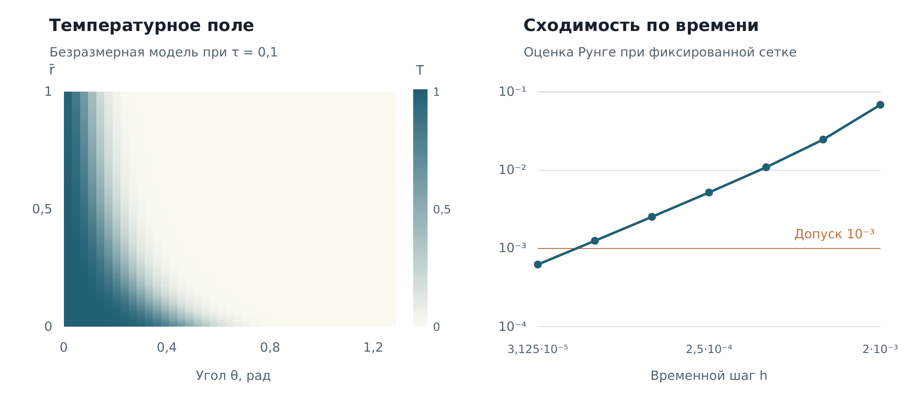

## Теплообмен на Python: расчёт и контроль сходимости

Я решал учебную задачу конвективного теплообмена с помощью NumPy. При подготовке портфолио повторил расчёт из отчёта и сохранил температурное поле, параметры и историю уменьшения временного шага.

При шаге **3,125 × 10⁻⁵** оценка временной погрешности — **6,21 × 10⁻⁴**, ниже допуска **10⁻³**. Наблюдаемый порядок — **1,0084**.



*На рисунке показан участок θ до 1,3 рад. Полное поле рассчитано до π; время безразмерное, τ = 0,1.*

### Применённые навыки

| Навык аналитика | Как я его применил |
|---|---|
| Формализация задачи | Перевёл физическую постановку в параметры, начальные и граничные условия |
| Работа с массивами | Рассчитывал поле на сетке 101 × 101 в NumPy |
| Проверка надёжности модели | Контролировал устойчивость явной схемы и граничные невязки |
| Анализ точности | Уменьшал временной шаг и оценивал сходимость |
| Воспроизводимость | Сохранил параметры, результаты и код повторения |
| Интерпретация | Отделил численную точность от достоверности прогноза реального объекта |

### Сохранённые результаты

| Показатель | Значение |
|---|---:|
| Пространственная сетка | 101 × 101 |
| Конечное время | 0,1 |
| Итоговый временной шаг | 0,00003125 |
| Оценка временной погрешности | 0,000621254 |
| Допуск | 0,001 |
| Наблюдаемый порядок | 1,0084 |

### Пример кода

```python
from heat_model import Parameters, solve

parameters = Parameters(time_step=0.00003125, final_time=0.1)
solution = solve(parameters, snapshot_times=())
print(solution.temperature.shape)  # (101, 101)
```

### Как повторить и проверить

```bash
python -m pip install -r requirements.txt
python reproduce.py
python check_saved_result.py
```

- [heat_model.py](heat_model.py) — переносимый вариант программы из учебного отчёта.
- [reproduce.py](reproduce.py) — повторяет расчёт и сравнивает осевой профиль с сохранённым.
- [check_saved_result.py](check_saved_result.py) — короткий пример контроля допуска и граничных невязок по сохранённому результату.
- [heat-results.json](heat-results.json) — параметры, история сходимости и контрольные значения.
- [saved-field.csv](saved-field.csv) — полное температурное поле.

### Для каких аналитических задач это полезно

Проверка расчётных моделей, поиск источников численной ошибки, ведение воспроизводимых вычислений и объяснение точности результата. Такой контроль помогает избежать вывода по красивому, но непроверенному графику.

### Дополнительный опыт

В Excel сравнивал модели Мальтуса и Ферхюльста по одному временному ряду: RMSE 0,245553 и 0,050804 млрд человек. Для электрических цепей применял МНК и проверял невязки балансов. Эти работы остаются дополнительным учебным опытом; отдельные реализации в этом репозитории не представлены.

### Ограничения

Здесь проверена временная погрешность при фиксированной пространственной сетке. Пространственную сходимость, адекватность физической модели и прогноз реального объекта нужно проверять отдельно.

---

[← Все проекты](https://github.com/antonyakovlev11)
