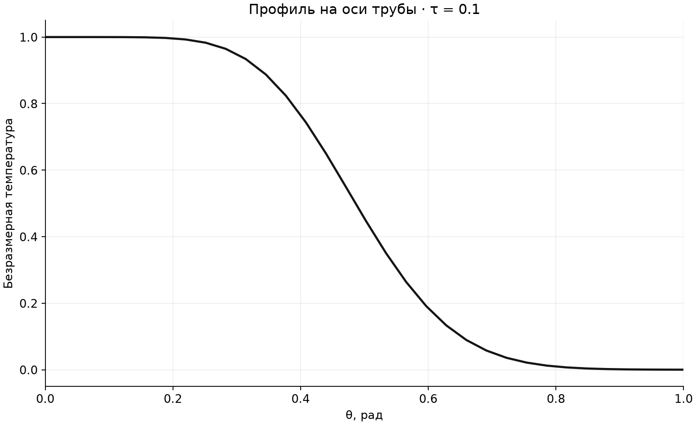
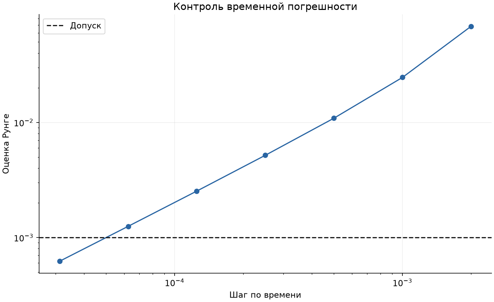

# Последняя сборка численной модели

Температурное поле рассчитываю в `heat_model.py`; здесь показываю профиль температуры и контроль временной погрешности.

Сетка: **101 × 101**; конечное время: **0.1**.

Принятый шаг: **3.125e-05**; оценка Рунге: **0.00062125425**; допуск: **0.001**.

Максимальная граничная невязка: **2.61e-15**.

[PNG](heat-overview.png) · [SVG](heat-overview.svg)

[SVG профиля](heat-axis.svg)

[SVG сходимости](heat-convergence.svg)

[Полное поле CSV](temperature-field.csv) · [История сходимости](convergence.csv) · [Результаты и параметры](model-results.json) · [Разбор проекта](../README.md)

Проверка относится к временному шагу при фиксированной пространственной сетке. Адекватность физической модели и пространственную сходимость нужно оценивать отдельно.
